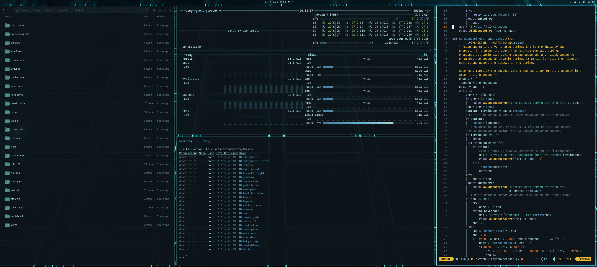

# Omarchy – Tron: Legacy theme

An [Omarchy](https://omarchy.org/) theme based on the "Grid" look from *Tron: Legacy*:
ice-teal text on a deep teal-black background, with a cyan accent.



## What's included

| File | What it does |
|---|---|
| `colors.toml` | The palette. Drives the terminals, bar, menus, launcher, notifications, lock screen, Neovim and VS Code |
| `hyprland.lua` | Ice-cyan active window border with a tight cyan glow; dim teal for inactive windows |
| `btop.theme` | Teal/cyan graphs, amber and red only for heat and load |
| `icons.theme` | `Yaru-prussiangreen` icons |
| `keyboard.rgb` | Accent cyan for supported keyboards |
| `backgrounds/neon-grid.png` | Wallpaper |
| `extras/gtk/` | Optional: makes Files and other GTK apps follow the active theme |

## Install

```bash
git clone https://github.com/ckbrewer33/omarchy-tron-legacy-theme
cd omarchy-tron-legacy-theme
./install.sh            # add --no-gtk to skip the GTK colors
```

`omarchy theme install <repo-url>` also works, but Omarchy drops `hyprland.lua` from themes
installed that way, so you would lose the border glow. Use `install.sh`, or copy `hyprland.lua`
into the installed theme folder yourself.

## Palette

| Role | Color |
|---|---|
| background | `#0d151a` |
| foreground | `#a6d8d6` |
| accent / cyan | `#6fc3df` |
| red / orange / yellow | `#e5483a` / `#e9783a` / `#f0c034` |
| green | `#4fb5a0` |
| muted | `#5f777f` |

Colors were sampled from stills of the film's Grid scenes.

## Notes

- The GTK hook re-renders `~/.config/gtk-4.0/gtk.css` and `~/.config/gtk-3.0/gtk.css` every time you
  change theme, so it works with any Omarchy theme. It overwrites those two files.
- Fan-made and not affiliated with or endorsed by Disney. *TRON* is a trademark of Disney Enterprises, Inc.
- The wallpaper is an AI-generated image supplied by the theme's author, not an official asset.
